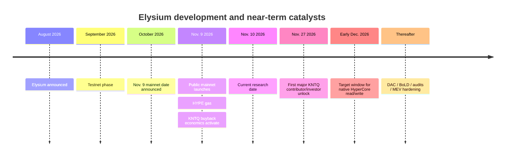
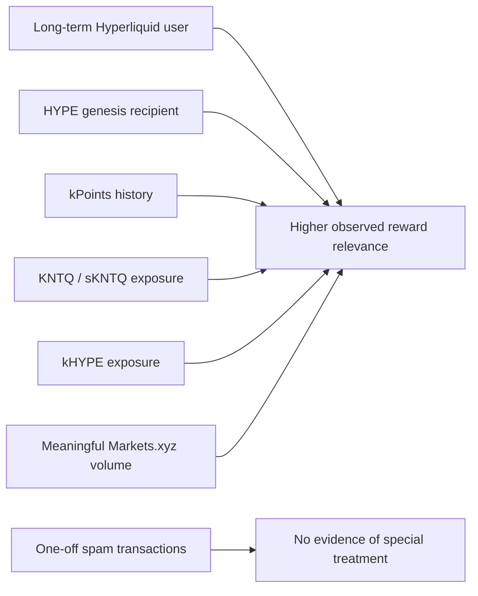
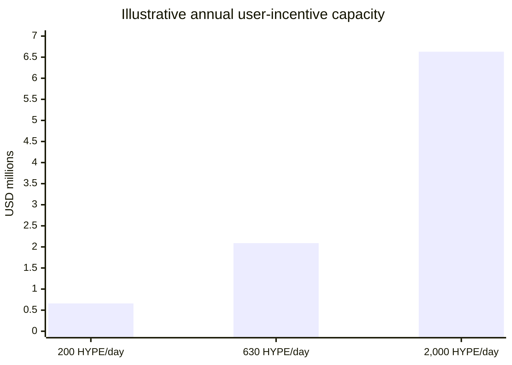

# Elysium Mainnet and Airdrop Research Report

## Executive summary

**Elysium is not best understood as a conventional “new L2 → farm points → receive native token” opportunity.** It is Kinetiq’s high-performance EVM execution layer for the Hyperliquid ecosystem, launched publicly on **November 9, 2026**, using **HYPE as its native gas asset** and settling to HyperEVM. Kinetiq explicitly designed Elysium so users do **not** need a new gas token; meanwhile, Kinetiq already has an established governance/value-accrual token, **KNTQ**. Elysium routes **50% of sequencer revenue to KNTQ buybacks** and reserves **25% for builders**, making KNTQ and app-level incentive programs the most obvious economic beneficiaries of network growth. citeturn219608view0turn546211view0turn713183view0

**My estimated probability of a separate Elysium-native token airdrop over the next 12 months is only ~10%.** I assign materially higher probabilities to **additional KNTQ ecosystem distributions or subsidized claims (~40%)** and especially **builder/app-specific rewards, points, rebates or airdrops (~80%)**. Those are analytical estimates, not official guidance. The distinction matters: blindly spamming Elysium transactions in expectation of an “ELYSIUM” token looks like a poor expected-value strategy today. Elysium documentation, its HYPE-denominated design, KNTQ’s value-accrual role, and the absence of an official Elysium points program all point the other way. citeturn546211view0turn713183view0turn345866search1turn345866search3

There **is already evidence that genuine historical ecosystem participation matters**. The November 9 commemorative “Enter Elysium” NFT allowlist included holders of Hypurr NFTs, HYPE genesis recipients, former kPoints users, wallets with more than 10,000 KNTQ-equivalent, users holding more than 1 kHYPE, KNTQ buyers on OpenSea, and wallets with over $100,000 of Markets.xyz volume. All 8,888 NFTs subsequently minted. This is not a fungible-token airdrop, but it is the clearest post-mainnet evidence of the attributes Kinetiq and its partners chose to reward. citeturn769082search0turn769082search3turn769082search5

iturn512129image2

Kinetiq also has a meaningful historical precedent for distributing tokens to users. At KNTQ genesis in November 2025, **25% of the 1 billion maximum supply** was allocated to an initial airdrop—24% to kPoints participants and 1% to Hypurr holders. A subsequent kPoints program allocated **50 million KNTQ**, although this second campaign controversially gave qualifying users the right to acquire KNTQ at a fixed $0.26 rather than delivering a conventional free airdrop. Kinetiq also applied Sybil filters and redistributed rewards away from malicious users. citeturn184820search3turn184820search1turn861517search0turn861517search5

The investment case is therefore more compelling than the pure-airdrop case. A reasonable speculative Elysium strategy would emphasize **HYPE/kHYPE exposure, carefully sized KNTQ exposure, established-protocol LP activity, and targeted participation in apps with explicit incentives**, rather than purchasing random newly launched Elysium tokens. KNTQ has particularly direct Elysium exposure because 50% of sequencer revenue is earmarked for KNTQ purchases, but it also faces an important **November 27, 2026 vesting unlock of roughly 12.92 million KNTQ**, equivalent to about 4% of the currently reported circulating supply. citeturn219608view0turn711765search1

The strongest actionable opportunity from November 10 onward is thus **optionality farming rather than a single-airdrop bet**: maintain a real history of bridging HYPE, using established applications, holding or staking relevant ecosystem assets where economically justified, and selectively joining explicit points/airdrop programs such as those emerging from Elysium applications. Do not manufacture thousands of meaningless transactions; Kinetiq's prior campaigns demonstrate both longitudinal participation weighting and anti-Sybil screening. citeturn184820search1turn769082search0

## Project architecture, team, backers and timeline

Elysium is an **Arbitrum Orbit/Nitro chain built with Conduit infrastructure**, settling its rollup state to HyperEVM rather than Ethereum. Its public target is approximately **100 ms canonical blocks and 300 million gas/second**, which Kinetiq describes as about 600 times HyperEVM's large-block throughput. HYPE bridges 1:1 and is used directly as gas; there is no wrapped “Elysium gas token” required for normal use. Alchemy is the primary RPC infrastructure provider, while Uniswap, OpenSea and other ecosystem applications were available or announced around launch. citeturn546211view0turn219608view1turn251742search1turn496835search5

At launch, however, decentralization is limited. Elysium uses a **single sequencer, permissioned validation and a single Conduit data-availability service**, with full-data fallback. Optimistic withdrawals to the settlement chain take approximately **5.5 days**. Kinetiq says further hardening will include a broader DAC, permissionless BoLD validation, additional audits, MEV telemetry and potentially Timeboost. These are meaningful distinctions from the marketing shorthand “600× faster”: performance is high partly because Elysium currently accepts a more centralized operational model than a mature permissionless rollup. citeturn546211view0turn713183view3

A major functional upgrade is expected roughly **four weeks after public mainnet**, placing it around early December 2026 if schedule targets hold. The upgrade is intended to add native HyperCore reads and trade-writing capabilities, allowing smart contracts on Elysium to compose more directly with Hyperliquid's order-book liquidity and trading infrastructure. Until then, part of Elysium's strongest long-term thesis remains prospective rather than fully delivered. citeturn546211view0

The public launch date and the planned approximately four-week HyperCore integration window come directly from Kinetiq's launch materials; the November 27 unlock comes from the published KNTQ vesting schedule. citeturn219608view0turn546211view0turn711765search1

Kinetiq itself is considerably more established than a typical anonymous airdrop farm. Kinetiq Research Pte. Ltd. is a Singapore entity, and the protocol raised a reported **$1.75 million seed round** involving Maven 11, Pier Two, Chorus One Ventures, IMC Crypto, Infinite Field, Flowdesk and Susquehanna. Publicly identified leadership includes co-founder/CTO Justin Greenberg; other reporting identifies co-founders including the pseudonymous Omnia and Magnus Lai. citeturn513699search1turn793702search4turn793702search5turn793702search8

There is nevertheless a transparency limitation: Kinetiq's public GitHub organization does not expose a broad, complete Elysium-specific codebase comparable with a fully open-source rollup project. The underlying Arbitrum stack is public and core deployed addresses are published, but investors should distinguish “uses open-source Arbitrum technology” from “every Elysium-specific production component is independently inspectable.” citeturn546211view2turn713183view1

### Core mainnet contracts

The official Elysium documentation publishes the following high-value addresses. citeturn713183view1

| Component | Network | Address |
|---|---|---|
| Rollup | HyperEVM | `0x508C173dFe5F737B3493195Bf785d71fA76fD217` |
| Bridge | HyperEVM | `0x503D572157113fAaaD4DbeD2647Bb10b949216B6` |
| Inbox | HyperEVM | `0xce59f8B65ad41C9DAE4c07A0571a39824bD92cff` |
| Outbox | HyperEVM | `0xeC6B106DfA14428FE5Eec2a4065a7be599f02728` |
| Sequencer Inbox | HyperEVM | `0x7f3Ff53aecB87261206ad3bDc27A88b6D8420fa6` |
| Challenge Manager | HyperEVM | `0xe9E62B91917b4a1930C2F638Cb67c19387aC57c8` |
| Gateway Router | Elysium | `0x61EbbC3A29f1970aF2Ce862bA9c5364832E14d17` |
| ERC-20 Gateway | Elysium | `0x5DC84e4Cb0F9082246E92a5585C5395592B1aF1f` |
| WHYPE | Elysium | `0xbA876237B0F021A6c6D852d6c26E107997cC5E81` |
| USDC | Elysium | `0xb47c4C8F73F009CC0C0d3f92B388d13E293F0B65` |
| Multicall3 | Elysium | `0xcA11bde05977b3631167028862bE2a173976CA11` |

The chain's official explorer and transaction feed should be treated as the canonical starting point for current Elysium activity; the settlement contracts can be independently inspected on HyperEVM explorers. OpenSea likewise identifies HYPE as the chain token and points users to Elysium's official explorer. citeturn769082search2turn713183view1

## Tokenomics and economic value capture

Elysium itself currently has **no announced standalone tokenomics**. Its economic architecture instead connects HYPE and KNTQ: HYPE is the gas asset, while KNTQ is Kinetiq's governance and protocol-value-accrual instrument. That architecture is one of the strongest pieces of evidence against assuming an imminent separate Elysium token. citeturn546211view0turn713183view0

KNTQ has a **maximum supply of 1 billion tokens** and launched on November 27, 2025. Public allocation disclosures put approximately 30% into protocol growth/rewards, 25% into the initial airdrop, 23.5% into core contributors, 10% into the Foundation, 7.5% into investors and 4% into liquidity. Core contributor and investor allocations have a three-year total schedule: a one-year cliff followed by two years of monthly linear vesting. citeturn713183view0turn184820search3turn711765search7

| KNTQ allocation | Share | Approx. tokens | Main implication |
|---|---:|---:|---|
| Protocol growth / rewards | 30.0% | 300M | Large remaining pool potentially usable for future ecosystem incentives |
| Initial airdrop | 25.0% | 250M | Strong historical precedent for community distribution |
| Core contributors | 23.5% | 235M | One-year cliff ends Nov. 27, 2026; then monthly vesting |
| Foundation | 10.0% | 100M | Strategic treasury; detailed release timing remains less explicit |
| Investors | 7.5% | 75M | One-year cliff + 24-month linear vesting |
| Liquidity | 4.0% | 40M | Market liquidity |
| **Total** | **100%** | **1B** | Maximum supply |

The economically important near-term event is **November 27, 2026**. DeFiLlama currently estimates a 12.92 million KNTQ unlock split between contributors and investors, approximately 3.99% of the currently reported circulating supply. Because contributor and investor tokens then vest monthly for two years, similar recurring supply additions should be expected under the disclosed schedule unless governance changes it. citeturn711765search1turn713183view0

At a rough KNTQ spot price of **$0.34** during this research snapshot, 12.92 million KNTQ represents about **$4.39 million of nominal token value**. CoinGecko and CoinMarketCap were both pricing KNTQ around the mid-$0.30s at the time of research; actual execution prices will vary. citeturn513699search4turn513699search5

KNTQ's value-accrual mechanism is unusually relevant to Elysium. Kinetiq states that **50% of Elysium sequencer revenue is used for KNTQ buybacks**, while 25% is allocated to builders. More broadly, Kinetiq routes defined shares of revenues from liquid staking, validators, trading and other products to buybacks. Under KIP-5, future protocol-funded buyback tokens are directed to Hyperliquid's Assistance Fund address rather than distributed as staking yield to sKNTQ holders; Kinetiq treats this as permanent removal from usable circulation. citeturn219608view0turn713183view0turn683594search2

That KIP-5 change is critical for anyone considering staking KNTQ. **sKNTQ should no longer be modeled as a 13%-type buyback-yield instrument.** Historical buybacks were previously distributed to stakers, but KIP-5 redirected them. Today the rationale for sKNTQ is governance and Kinetiq ecosystem privileges, with a seven-day unstaking period, rather than direct cash flow from Elysium sequencer fees. citeturn683594search2turn713183view0

A useful stress test illustrates the scale required for Elysium buybacks to counteract the upcoming unlock. With 12.92 million KNTQ worth about $4.39 million at $0.34, and only 50% of Elysium sequencer revenue going to buybacks, Elysium would need roughly **$8.79 million of monthly sequencer revenue, or ~$293,000/day**, to equal that unlock's nominal value through Elysium buybacks alone. At a HYPE price near $72.69, that is roughly **4,030 HYPE/day of sequencer revenue**. This is an economic sensitivity calculation—not a forecast and not an assumption that unlocked holders will sell. The KNTQ and HYPE price inputs are market snapshots. citeturn513699search4turn450344finance0

## Airdrop evidence, on-chain activity and community signals

### What is actually announced

As of **November 10, 2026**, there is **no official Elysium-native fungible token, no official Elysium-wide points system, and no announced retroactive chain airdrop**. Official documentation instead says HYPE bridges 1:1 and is used as gas without introducing a new token. Independent airdrop trackers reaching the same conclusion should be treated as secondary confirmation rather than as the primary evidence. citeturn546211view0turn345866search1turn345866search3

The absence of a chain-wide token does **not** mean there is no reward opportunity. Kinetiq's architecture explicitly directs 25% of Elysium sequencer revenue to builders, creating a sustainable source that applications can use for incentives. The ecosystem already includes protocols advertising their own points, token economics, LP rewards or airdrop mechanisms. citeturn219608view0turn178080view0

### Historical Kinetiq precedent

The first KNTQ distribution is a strong positive precedent. Twenty-five percent of supply was allocated to the community at genesis, principally through kPoints accumulated over sustained protocol participation. The program applied anti-Sybil criteria, including filtering malicious behavior and redistributing affected allocations. That suggests **quality and persistence of activity are likely more valuable than raw transaction counts** in any future Kinetiq-directed campaign. citeturn184820search1turn184820search3

The second precedent is more ambiguous. After approximately 46 weeks and 36.8 million accumulated kPoints, Kinetiq allocated 50 million KNTQ for a claim at a fixed **$0.26 per token** rather than giving all tokens away for free. About 67.4% was ultimately claimed, with the remainder returning to the Foundation for ecosystem/growth purposes. This episode demonstrates both a willingness to reward users and an important caveat: **“points” do not necessarily equal a free airdrop**. citeturn861517search0turn861517search5

Public community criticism around that conversion exists, including complaints that months of point farming resulted in a purchase entitlement rather than the expected free distribution. The Reddit evidence is a very small sample and should not be treated as representative sentiment, but it is a legitimate reputational warning against assigning face value to implied future rewards. citeturn496835reddit10

### Post-mainnet distribution evidence

The clearest official post-launch distribution is the **8,888-item “Enter Elysium” commemorative NFT**. Its allowlist rewarded seven categories of historical or economically meaningful activity, including HYPE genesis recipients, Hypurr holders, former kPoints users, >10,000 KNTQ-equivalent holders, >1 kHYPE holders, KNTQ buyers on OpenSea and users with >$100,000 Markets.xyz volume. OpenSea subsequently showed all 8,888 items minted and more than 5,000 unique owners. citeturn769082search0turn769082search3

This makes the NFT far more useful analytically than a random marketing collectible. It reveals a recognizable preference function:

Those relationships are inferred from the published NFT criteria; they are **not** official future-airdrop rules. citeturn769082search0turn769082search5

There is also at least one concrete app-level distribution underway. **Eleos** has advertised an EOS distribution for Elysium traders, including trading-volume-based allocation with Sybil clustering and square-root weighting. Its current campaign has included a November 11 snapshot window. This should not be confused with an Elysium/Kinetiq airdrop: it is an application-specific incentive, and Eleos itself has indicated that an external audit was not yet complete in the material reviewed. citeturn896461search4turn896461search5turn896461search6

Another particularly interesting category is applications with explicit points. Elysium's official ecosystem directory describes **Elyra** as an isolated HYPE/USDC lending platform with points rewards. That creates clearer airdrop optionality than generic transaction farming, although a points program still provides no guarantee of a token or valuation. citeturn421653view0

### On-chain launch activity

The official explorer was already reporting roughly **14.9 million transactions, ~590,000 addresses and more than 200,000 contracts indexed** during this research snapshot, with short-window transaction throughput around the tens of TPS. It also reported millions of project interactions and several million dollars of ecosystem TVL. These totals require caution because Elysium had pre-mainnet/test activity and the explorer itself notes that its indexing/history metrics are still being populated; they should not all be interpreted as unique organic post-November-9 economic users. citeturn389596view0turn158790view2turn158790view3

Likewise, the explorer's “volume” figure measures gross token movements through indexed project contracts rather than being equivalent to audited DEX spot volume. Current token activity nonetheless demonstrates substantial speculative use immediately around launch: KNTQ itself appeared among the higher-volume assets in explorer statistics alongside numerous newly launched tokens. citeturn158790view3turn389596view0

Launch was not completely frictionless. QuickNode reported transaction-submission failures on November 9 tied to upstream sequencer rate limiting, and Conduit publicly acknowledged rate limiting under extraordinary initial demand. The incident was resolved, but it is an important real-world counterpoint to theoretical peak-throughput figures: network capacity, RPC capacity and sequencing infrastructure are separate bottlenecks. citeturn496835search0turn496835search1

Community reporting estimated roughly **630 HYPE in fees during the first 24 hours**, versus much lower activity immediately before launch. Because this comes from a community analyst rather than a canonical protocol accounting endpoint, I treat it only as an order-of-magnitude estimate. At today's HYPE snapshot, 630 HYPE would equal roughly $45,800 of daily sequencer revenue and approximately $22,900 notionally earmarked for the 50% KNTQ buyback allocation. citeturn683594search7turn450344finance0

I did **not** find a transaction that could be independently and unambiguously attributed to the first Elysium-specific KNTQ sequencer-revenue buyback. Public KNTQ buyback trackers aggregate several Kinetiq revenue sources, making attribution unsafe. Therefore, I would not claim that an Elysium-funded buyback has already been proven on-chain merely because KNTQ buyback transactions exist. The routing mechanism itself is official. citeturn713183view0turn683594search4

### Sentiment

Official X and Telegram sentiment is unsurprisingly strongly positive, emphasizing launch throughput, OpenSea/Uniswap/Alchemy integrations and rapid transaction growth. The commemorative NFT and significant launch engagement suggest strong attention from existing Hyperliquid/Kinetiq users. citeturn769082search1turn769082search5turn496835search9

The more useful contrary signals are the launch RPC incident and lingering dissatisfaction among some former kPoints participants. Together, they suggest the market's two major near-term credibility tests are **operational reliability under sustained load** and **clear communication around incentives**. I could not obtain a reliable, representative indexed Discord corpus, so this sentiment assessment deliberately relies on official Telegram/X material, public infrastructure incident reports and publicly searchable community discussion rather than claiming a Discord consensus.

## Airdrop probabilities and scenario analysis

The following probabilities are **my analytical estimates as of November 10, 2026**, not probabilities supplied by Kinetiq.

| Outcome by Nov. 2027 | Estimated probability | Rationale |
|---|---:|---|
| Separate Elysium-native token + broad retroactive airdrop | **~10%** | HYPE is deliberately native gas; KNTQ already captures Elysium value; no token/points announcement |
| Additional KNTQ reward/distribution tied to Elysium activity | **~40%** | 30% growth/reward allocation; strong Kinetiq distribution precedent; Foundation retains ecosystem inventory |
| Elysium-builder/app incentives, points or token airdrops | **~80%** | 25% builder revenue allocation plus several apps already running or advertising incentives |
| Some meaningful user reward on Elysium from at least one app | **Effectively already occurring** | Eleos distribution and other explicit points/reward programs are live or announced |
| Meaningless transaction spam receives special treatment | **Low** | No supporting evidence; Kinetiq historically uses anti-Sybil filtering and rewards sustained ecosystem relationships |

The first three estimates are judgments derived from Elysium's architecture, KNTQ tokenomics, Kinetiq's prior distribution history and current app programs. citeturn546211view0turn713183view0turn184820search1turn219608view0

### Hypothetical future KNTQ campaign

If Kinetiq chose to use some of the protocol-growth allocation for a future Elysium campaign, the following illustrates the possible economics. **No such campaign has been announced.** I use a $0.34 KNTQ reference price only to make the scales intuitive. citeturn513699search4

| Scenario | KNTQ allocated | % max supply | Assumed qualifying wallets | Equal-weight avg. KNTQ | Approx. value/wallet at $0.34 |
|---|---:|---:|---:|---:|---:|
| Conservative | 5M | 0.5% | 100,000 | 50 | **$17** |
| Base | 15M | 1.5% | 75,000 | 200 | **$68** |
| Aggressive | 50M | 5.0% | 50,000 | 1,000 | **$340** |

Real Kinetiq distributions have not been equal-weight; contribution, points, holdings and anti-Sybil factors can create a highly skewed result. The aggressive 50 million-token case is not arbitrary in magnitude—it matches the scale of Kinetiq's second kPoints allocation—but there is no evidence that it will be repeated for Elysium. citeturn861517search0

### Builder-revenue reward capacity

Another way to estimate the economic ceiling is to model the 25% sequencer-revenue share reserved for builders. Using the current HYPE snapshot of $72.69 and assuming, purely illustratively, that builders redirect half of their allocation into user incentives: citeturn450344finance0turn219608view0

| Sequencer revenue | Annual gross revenue | 25% builder allocation | If 50% of builder allocation rewards users |
|---|---:|---:|---:|
| 200 HYPE/day | $5.31M | $1.33M | **$0.66M/year** |
| 630 HYPE/day | $16.72M | $4.18M | **$2.09M/year** |
| 2,000 HYPE/day | $53.06M | $13.27M | **$6.63M/year** |

The implication is important: **even very successful network activity does not automatically imply a huge per-wallet airdrop**. If $2.09 million were spread over 75,000 qualifying wallets, the simple average would be only about $28 per year. Material rewards require either sharply higher sequencer revenue, concentrated weighting toward valuable users, separate token incentives, or treasury subsidies. This is why capital-intensive farming purely for an unspecified Elysium reward is unattractive at present.

## Investment options, risks and recommended positioning

The ecosystem directory already contains established infrastructure such as Uniswap and OpenSea alongside very young lending, launchpad and trading applications. Kinetiq explicitly states that inclusion in its ecosystem directory is **not an endorsement**, which should be taken seriously when evaluating newly deployed contracts. citeturn178080view0

| Strategy | Return source | Airdrop optionality | Liquidity | Primary risks | Relative view |
|---|---|---|---|---|---|
| **Hold HYPE** | HYPE appreciation | Medium | High | HYPE market risk | **Strong core exposure** |
| **Stake HYPE → kHYPE** | Hyperliquid staking rewards | Medium-high; >1 kHYPE was NFT criterion | High/moderate | Smart-contract, validator, depeg risk | **Best risk-adjusted ecosystem exposure** |
| **Buy KNTQ** | Price appreciation + buyback-driven supply reduction | Medium | Moderate-high | Nov. 27 unlock, volatility, execution of Elysium thesis | **High-conviction satellite position** |
| **Stake KNTQ → sKNTQ** | Governance/tier utility; not direct buyback yield | Medium-high | 7-day exit | KNTQ price + lock/liquidity risk | **Useful only if benefits matter** |
| **HYPE/USDC or established-pair LP** | Swap fees + possible incentives | High | Moderate | Impermanent loss, smart-contract risk | **Good if already willing to LP** |
| **Explicit points programs such as Elyra** | Lending yield + potential future incentive | High | Varies | Young contracts, liquidation/oracle risk | **Small experimental allocation** |
| **Early token/launchpad farming** | Token appreciation + incentives | Very high | Low/variable | Rug, exploits, insider supply, illiquidity | **Highest-risk bucket** |
| **Transaction spam** | Undefined future reward | Low/unknown | N/A | Gas cost, Sybil exclusion | **Avoid** |

Kinetiq's liquid-staking product lets HYPE holders receive kHYPE while staking rewards accrue through the exchange rate; official contracts are published. A prior Elysium NFT criterion specifically recognized wallets with more than 1 kHYPE, providing some evidence—though no guarantee—that productive Kinetiq exposure can also have ecosystem-reward optionality. citeturn546211view3turn769082search0

For KNTQ, the bull case is structurally cleaner: greater Elysium fee generation produces more KNTQ purchases under the current rules. The bear case is equally clear: launch excitement can fade, sequencer fees can compress, and approximately 12.92 million contributor/investor tokens begin unlocking on November 27. Buying KNTQ immediately after a mainnet narrative catalyst without accounting for that supply event offers weaker asymmetry than staged entry. citeturn219608view0turn711765search1

### Model speculative allocation

For capital specifically designated as a **high-risk Elysium/Hyperliquid ecosystem sleeve**, rather than an overall investment portfolio, a defensible model is:

- **40% HYPE/kHYPE**, favoring kHYPE where the incremental smart-contract risk is acceptable; **15% KNTQ**, with purchases staged around the November 27 vesting event rather than deployed all at once; **15% established-protocol LPs**, preferably pairs whose inventory risk you already want to own; **10% explicit app-level incentive/points strategies**, diversified rather than concentrated in one unaudited protocol; and **20% reserve**, retained for the HyperCore integration, post-unlock volatility and better-defined incentive campaigns.

This allocation is deliberately less aggressive on KNTQ than the strongest narrative case because Elysium is only one day into public mainnet and the unlock schedule is imminent. The staged approach can be reconsidered after observable sequencer revenue, KNTQ buyback transactions and the HyperCore read/write upgrade provide harder evidence. citeturn711765search1turn546211view0

### Risk matrix

| Risk | Probability | Impact | Why it matters now |
|---|---|---|---|
| Sequencer / RPC operational failure | Medium | Medium-high | Launch already experienced rate limiting |
| Centralization / validator risk | High by design today | High in tail event | Single sequencer, permissioned validation |
| Data-availability failure | Low-medium | High | Single Conduit DAS at launch, although fallback exists |
| Bridge / rollup contract exploit | Low-medium | Very high | Bridged capital depends on rollup/gateway security |
| HyperCore integration delay | Medium | Medium | Key differentiated functionality is still post-launch |
| KNTQ unlock pressure | High/certain unlock | Medium-high | 12.92M scheduled Nov. 27 |
| Elysium-native airdrop fails to materialize | High | High for farmers | No official token/points program |
| App-level rug/exploit | High across immature apps | Very high | Many contracts/tokens are new; listing is not endorsement |
| Regulatory restrictions | Medium, jurisdiction-dependent | Medium-high | Staking, tokens, perpetual/trading apps and RWAs can trigger local rules |
| Core Kinetiq rug/exit | Low relative to new apps | Very high tail risk | Established entity/backers/TVL lower—but cannot remove—custodial/governance risk |

The technical-risk ratings reflect Elysium's published launch architecture and the observed launch RPC incident. App risk is particularly heterogeneous: some integrations involve mature protocols, while others are newly deployed and may have limited auditing. citeturn713183view3turn496835search0turn178080view0

### Recommended actions from November 10 onward

**First, establish high-quality rather than high-volume on-chain history.** Bridge a modest quantity of HYPE using the official bridge; perform a few economically rational swaps; use one established LP venue if you would genuinely hold both assets; interact with one or two explicit incentive programs only after reviewing their contracts; and retain enough HYPE to demonstrate persistent ecosystem participation. Previous Kinetiq reward criteria favor durable economic relationships over raw transaction counts. citeturn184820search1turn769082search0

**Second, do not buy random Elysium tokens merely because they launched on day one.** The very low cost and high throughput make token creation easy, which increases—not decreases—the burden of due diligence. Prioritize applications listed by Elysium but independently verify contract ownership, upgradeability, audits, liquidity locks and token distribution. The ecosystem directory itself warns that listing does not equal endorsement. citeturn178080view0

**Third, stage KNTQ exposure around November 27.** The cleanest monitoring variables are daily sequencer revenue, the first independently traceable Elysium-funded KNTQ buybacks, KNTQ exchange liquidity and the market's absorption of the first contributor/investor unlock. If Elysium fee revenue remains near launch-day levels while the unlock begins, the economic buyback offset is modest; if revenue grows toward several thousand HYPE/day, the KNTQ thesis becomes materially stronger.

**Fourth, reassess after HyperCore integration.** Native HyperCore reads/writes are arguably more important to Elysium's differentiated long-term value than day-one transaction counts because they enable applications to compose with Hyperliquid's core liquidity. A successful early-December rollout with stable operations would justify increasing exposure more than an unverified rumor of an Elysium token. citeturn546211view0

**Fifth, treat app-specific airdrops as venture-like bets.** An explicit campaign such as Eleos or points such as Elyra has a higher probability of producing a defined reward than generic Elysium farming, but the probability of smart-contract loss is also materially higher. Keep each unaudited/new protocol exposure small enough that a total loss is tolerable. citeturn896461search4turn896461search5turn421653view0

The core conclusion is therefore: **Elysium looks more compelling as a new economic layer benefiting HYPE, KNTQ and emerging applications than as a traditional native-token airdrop farm.** The highest expected-value approach today is to acquire authentic ecosystem history at low cost while retaining capital for the November 27 KNTQ unlock and the expected December HyperCore upgrade. A separate Elysium-token airdrop should be treated as a low-probability bonus, not the investment thesis.

## Prioritized sources and on-chain references

The highest-priority research sources are the **official Elysium documentation and November 9 Kinetiq mainnet announcement**, which define architecture, HYPE gas, revenue allocation and the HyperCore roadmap; the **official KNTQ tokenomics/KIP documentation**, which defines supply, vesting, staking and buyback rules; the **official contract registry and explorer**, which should be used for live verification; and the **Arbitrum and Alchemy launch material**, which independently corroborates the underlying rollup architecture and infrastructure relationship. citeturn219608view0turn546211view0turn713183view0turn713183view1turn251742search1turn496835search5

For token distribution history and unlocks, The Defiant's KNTQ launch reporting and DeFiLlama's vesting data are the most useful independent references reviewed. For live community signals, Kinetiq's official Telegram and Elysium's official X announcements are preferable to rumor accounts. OpenSea provides independently observable evidence for the launch NFT distribution. citeturn184820search3turn711765search1turn769082search1turn769082search0

Useful direct references are the [Elysium explorer](https://elysium.kinetiq.xyz/explorer), [Elysium documentation](https://elysium.kinetiq.xyz/docs/what-is-elysium), [Elysium ecosystem directory](https://elysium.kinetiq.xyz/ecosystem), [HyperEVM Rollup contract](https://hyperevmscan.io/address/0x508C173dFe5F737B3493195Bf785d71fA76fD217), [HyperEVM Bridge contract](https://hyperevmscan.io/address/0x503D572157113fAaaD4DbeD2647Bb10b949216B6), [HyperEVM Inbox](https://hyperevmscan.io/address/0xce59f8B65ad41C9DAE4c07A0571a39824bD92cff), and the [Enter Elysium NFT distribution](https://opensea.io/collection/enter-elysium/overview). These addresses originate from Elysium's official registry. citeturn713183view1turn769082search0

For Kinetiq's pre-existing liquid-staking system, the published kHYPE address is `0xfD739d4e423301CE9385c1fb8850539D657C296D`; kmHYPE is `0x360C140E5344A1A0593D44B4ea6Fc7C3DAf0C473`; and vkHYPE is `0x9BA2EDc44E0A4632EB4723E81d4142353e1bB160`. These are HyperEVM deployments rather than evidence that the same contracts exist natively on Elysium. citeturn546211view3turn769082search9

Finally, an important evidentiary boundary remains: **I found no public transaction hash that I can responsibly label as an isolated Elysium-sequencer-funded KNTQ buyback as of this snapshot.** Existing Kinetiq buyback trackers aggregate protocol revenue from multiple products. Until a payment path can be traced from Elysium sequencer revenue through the KNTQ purchase and into the Assistance Fund address, claims about the exact amount already distributed or burned specifically because of Elysium should be treated as estimates rather than verified on-chain facts. citeturn713183view0turn683594search2turn683594search4